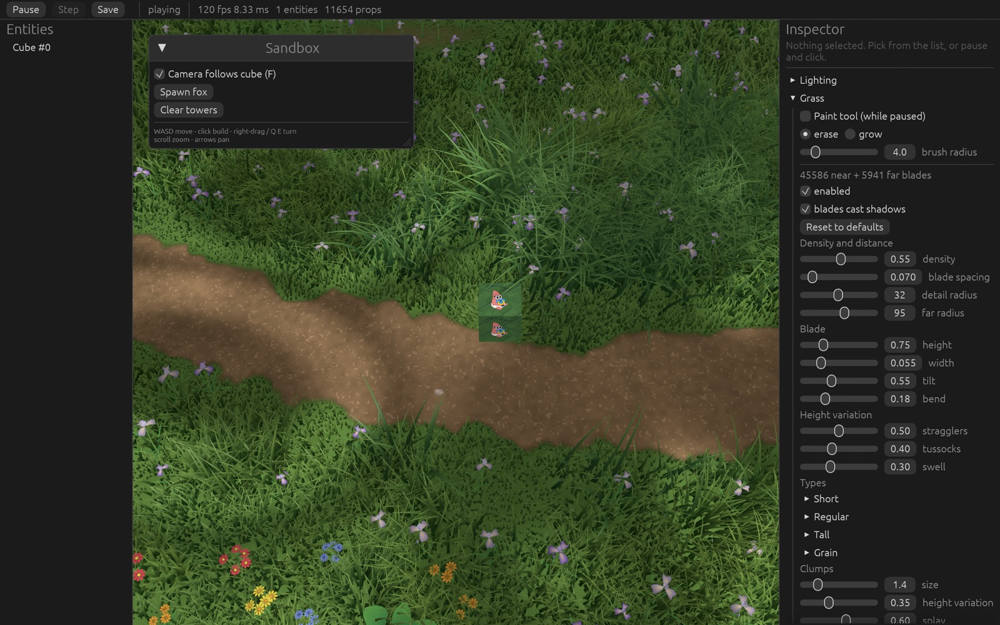

# grass-test

A real-time procedural grass field in Rust, using [wgpu](https://wgpu.rs) and [winit](https://github.com/rust-windowing/winit). There is no grass mesh and no grass model. Every frame, a compute shader decides where blades grow, what each one looks like, and which ones the camera can see. It writes the survivors into a GPU buffer, and an indirect draw renders them as curved triangle strips.



The technique follows Sucker Punch's GDC 2021 talk, *Procedural Grass in Ghost of Tsushima*. This project is a from-scratch Rust and WGSL take on it, with a live editor for tuning every parameter.

## Running

```sh
cargo run --release
```

| Input | Action |
|---|---|
| `WASD` | Move the cube (a grass "pusher") |
| Right-drag / `Q` `E` | Orbit the camera |
| Scroll | Zoom |
| Arrows / `F` | Pan / follow the cube again |
| Click | Build a tower |
| `F1` | Hide or show the editor |

The editor on the right exposes every grass setting as a slider. **Pause** it and enable the paint tool to brush grass in or out of the field. **Save** writes `assets/editor.json` and `assets/grass_density.png`, and both are loaded on the next start.

Debug builds (`cargo run`) hot-reload `.wgsl` files when you save them. A shader that fails to compile is reported in the editor, and the last good one stays active.

`CAPTURE=shot.png cargo run --release` renders one frame to a PNG and exits. `CAPTURE_FRAME=n` picks the frame.

## The idea

Grass has too many blades to store or simulate individually. A 200 m field at 7 cm spacing is about 8 million cells. So the field is never stored. Instead:

1. **A blade is a pure function of its grid cell.** Hash the integer cell coordinates, and you get the same random numbers every frame. The blade stays put, with no per-blade state on the CPU.
2. **Only cells near the camera are considered.** A grid of cells is laid out under the camera, in world-aligned coordinates, so blades don't swim as the grid follows the camera.
3. **The GPU culls, and the CPU never learns the count.** A compute shader appends visible blades to a storage buffer with an atomic counter. That counter is laid out as indirect draw arguments, so the draw reads the instance count straight from GPU memory.
4. **A blade is 64 bytes of parameters.** The vertex shader expands each one into a bent strip of triangles, and no vertex buffers exist.

```
 CPU (per frame)                    GPU
 ───────────────                    ───────────────────────────────────────────
 upload uniform (settings,   ──►    compute cs_main   one thread per candidate cell
 camera, wind, pushers)               hash cell → cull → LOD → density → species
 reset draw args to              ──►  → clump → variation → wind → pushers → cull
 [15,0,0,0] [7,0,0,0]                 atomicAdd(instance_count), write Blade
                                                │
                                                ▼
                                    render pass   draw_indirect (near), draw_indirect (far)
                                      vs_main  Bezier strip from Blade
                                      fs_main  lighting, shadows, colour
```

## Pipeline in detail

All of this lives in [`src/grass.wgsl`](src/grass.wgsl) (the shader) and [`src/app/grass.rs`](src/app/grass.rs) (buffers, pipelines, settings).

### 1. Candidate grid and level of detail

The compute pass dispatches 8×8 workgroups over a 2D grid, with a third dimension `z` of size 2 that selects the **level of detail**:

| LOD | `id.z` | Cells | Radius | Vertices per blade |
|---|---|---|---|---|
| Near | 0 | every cell (default 7 cm apart) | up to `near_radius` (32 m) | 15 (7 segments) |
| Far | 1 | every second cell | `near_radius` to `far_radius` (95 m) | 7 (3 segments) |

Each LOD has its own grid, centred on the camera and snapped to the cell size. This keeps the cell coordinates stable as the camera moves.

Cells whose two fine coordinates are both even exist in both LODs and use the same hash seed. A far blade is therefore the same blade as a near one, only drawn more simply, so nothing pops to a different position when it changes level. Coarse cells also jitter across a 2× area so the sparser grid still covers the ground.

**Blending across the LOD seam.** From 60% of `near_radius` out to the boundary:

- Non-coarse cells shrink to nothing (three blades in four disappear).
- Coarse cells widen up to 2×, which covers the gap the removed blades leave.

Near the far radius, every blade's height also fades out, so the field ends in turf rather than at a line.

### 2. Randomness

A [PCG](https://www.pcg-random.org/) integer hash of the cell coordinates seeds everything. `rand4(seed)` produces four independent floats in 0..1 per call. Different salts decorrelate the uses: jitter, orientation, species roll, flowers, and so on.

Value noise and a three-octave fBm are built on the same hash. They drive the wind, patches, dirt and flower drifts.

### 3. Cheap early culling

Most candidate cells are off screen. Before any costly work, the shader projects the cell's position (plus one metre up) and discards it if it is clearly outside the frustum. The margin is generous because the blade's height isn't known yet. A tighter test runs at the end, once the height is known (see step 10).

### 4. Painted density map

A 512×512 `R8` texture covers the whole field. It has two sources:

- **Painted density:** a soft-edged brush in the editor raises or lowers it, and it's saved as `assets/grass_density.png`.
- **Blocked areas:** props such as rocks and big plants stamp a hole around themselves. This layer is not saved.

The CPU takes the per-texel minimum of the two before upload. In the shader, the value multiplies blade height, so grass shrinks towards zero as the density does. The ground shader samples the same texture so the turf-to-dirt transition matches the grass.

### 5. Dirt, paths and worn patches

`dirt()` returns 0 for grass and 1 for bare soil. It is the max of:

- **Paths:** distance to the nearest of two analytic path curves, perturbed with fBm so the edges are ragged.
- **Worn patches:** thresholded fBm at a large scale.
- **Cleared ground:** `1 − density`.

Grass height falls off smoothly as this value rises and stops outright before bare ground. `trodden()` is a wider band beside paths and worn areas, and it biases those places towards short grass.

### 6. Large-scale variation

Large patches (default 14 m across) change the field's character in three ways:

- **Lush vs. sparse:** taller and thicker in some places, shorter and thinner in others. Some blades in sparse areas are dropped, which is a probabilistic cull.
- **Dryness:** a second noise field tints blades towards a dried-out colour and shortens them slightly.
- **Species:** four kinds of grass (short, regular, tall, grain), each with its own height, width, tilt, bend, density, wind response, colour and coverage. Each blade rolls for its own species against the local patch masks, so kinds mingle at their borders instead of meeting at a hard line.

### 7. Clumps

Real grass grows in tufts. For each blade, the shader runs a 3×3 Voronoi search: one random point per clump cell (default 1.4 m), and the nearest one wins. Blades in the same clump share:

- A **height multiplier**
- A **colour shift**, including a slight yellow-to-blue hue lean
- A **facing bias** that splays them outward from the clump's centre

This is the biggest single step in breaking up the lawn look. On top of clumps, three more variations stack: rare **stragglers** that stand well above their neighbours, whole-clump **tussocks** that are taller and broader, and a slow **swell** that raises and lowers heights every few metres. The final multiplier is clamped at 2× so the unluckiest blade can't become a tree.

### 8. Flowers and grain

- **Flowers** are blades flagged `kind = 1` or `2` (two colours). They are taller, straighter, and end in a wider head on the last ring. They appear in drifts, from a noise mask, with a low chance elsewhere.
- **Grain** is a thin stalk carrying a wider ear over its top rings.

Both use the same strip geometry as grass. Only the width profile and colour differ, so they cost nothing extra to draw.

### 9. Wind and interaction

- **Wind (compute):** two noise octaves slide across the field along the wind direction. The result is the per-blade `wind` strength, scaled by the species' wind response. Gusts therefore travel across the grass as visible waves.
- **Wind (vertex):** each blade also bobs on its own, with a sine phase from its hash. The sway displaces the tip and the whole blade renormalises to its original length, so wind bends grass without stretching it.
- **Pushers:** up to 8 entities (the cube, the fox) carry a `GrassPusher(radius)` component. Blades inside the radius turn to face away from the pusher and tilt towards flat. The effect is a smooth falloff from the full radius in to 30% of it.

### 10. Final cull and append

With height and tilt known, the shader projects the blade's midpoint and tests it against the frustum, with a margin that scales with blade height. A blade whose root is off screen but whose tip is visible is kept. The survivor is appended:

```wgsl
let slot = atomicAdd(&draws[lod].instance_count, 1u);
if slot < arrayLength(&near_blades) { near_blades[slot] = blade; }
```

Buffers are fixed-size (700,000 blades per LOD, 64 bytes each). If a frame produces more than that, the extras are dropped and the vertex shader draws nothing for the overflow. Raise `NEAR_CAPACITY` and `FAR_CAPACITY`, lower density, or shorten the radii if grass goes missing in patches.

### 11. Indirect draw

The draw-argument buffer holds two entries in the standard `DrawIndirect` layout (`vertex_count, instance_count, first_vertex, first_instance`). The CPU resets it to `[15, 0, 0, 0]` and `[7, 0, 0, 0]` each frame, and the compute shader increments `instance_count`. Two `draw_indirect` calls, at offsets 0 and 16, then draw the near and far sets.

The UI shows the blade counts. To get them without stalling, the CPU copies the draw args into a small mappable buffer after each dispatch and maps it asynchronously. It reads the previous result a frame or two later, and only one readback is in flight at a time. The renderer never depends on this.

## Blade geometry

The vertex shader receives only `vertex_index` and `instance_index`. There are no vertex buffers. For vertex `v` of a blade with `S` segments:

- `ring = min(v >> 1, S)`: pairs of vertices climb the left and right edges, and the last vertex is the tip.
- `t = ring / S`: position along the blade, 0 at the root and 1 at the tip.
- `edge = ±1` from `v & 1` (0 at the tip), so the strip has a point at the top.

**Spine.** A cubic Bézier curve runs from root to tip:

- `P0` is the root.
- `P3` is the tip. It sits `height` along a direction that leans over by `tilt` toward the blade's facing, is pushed by wind and sway, and is normalised so length never changes.
- `P1` and `P2` sit at 1/3 and 2/3 along the root-tip line and are pushed sideways by `bend × height`. This bows the blade so it isn't a straight stick.

The position and tangent come from the curve and its derivative.

**Width profile.** Full width at the root, narrowing as `1 − t²`, so the blade tapers to a point.

**View-space thickening.** A flat strip seen edge-on collapses to a line and the field thins out as the camera turns. The vertex shader measures how edge-on the blade is, `1 − |n·v|`, and pushes the vertices apart along the screen-space right vector by an amount scaled with the square of that. Blades stay visible from every angle at no extra geometry.

**Rounded normals.** The geometric normal is tilted outward at the edges, as if the blade were curved in cross-section. Lighting then varies across the blade even though it is flat.

## Shading

Fragment shader (`fs_main`), per fragment:

- **Colour:** root-to-tip gradient (`t²` bias), blended towards the dry colour by dryness and towards the species' own colour. Per-clump brightness and hue variation are applied, plus a small per-blade variation and a darker midrib along the centre.
- **Ambient occlusion:** a root-darkening term, so the base of the field sits in shade.
- **Two-sided lighting:** both faces are drawn (no culling), and the normal flips for back faces.
- **Translucency:** light that passes through the blade from behind adds to the diffuse term, controlled by a `translucency` setting. This gives the backlit glow of real grass.
- **Specular:** a Blinn-Phong highlight on the upper blade, fading with distance.
- **Distance normal blend:** far away, thousands of tiny blades each catching a different glint just sparkle. Normals lean towards straight up with distance, so the far field shades like a smooth surface.
- **Shadows:** a 3×3 PCF comparison sample against the sun's shadow map, with a fade at the map's edge.

Near blades are also rendered into the shadow map, from the light's viewpoint, with a depth-only pipeline. Far blades are not (they are too small to matter).

## The ground

The ground is drawn by the same shader file, since it needs the same `dirt()`, patches and density functions. A 200×200-square grid is generated entirely in the vertex shader from `vertex_index` (6 vertices per square, no mesh). The fragment shader computes:

- **Turf:** the mean grass colour, tinted by the same dry patches, so far-away ground matches the blades.
- **Soil:** broad fBm stains, grain noise up close, and small pale stones from a thresholded high-frequency noise. Fine detail fades with distance so it doesn't shimmer.
- **Wet earth:** a darker band where the grass gives out.
- **Normals:** the analytic terrain gradient, via central differences of the height function.

## Terrain: one formula, two languages

The field is not a heightmap. It is a sum of sines, `terrain::height(x, z)`, plus two analytic path curves. The same function appears in Rust (picking, pathfinding, prop placement) and in WGSL (grass roots, ground vertices). If the copies drift apart, the grass floats or sinks.

A unit test (`shader_terrain_matches_rust_terrain`) extracts the numeric literals from both functions and checks they are identical and in the same order. Edit both together.

## Performance notes

- All blade work happens on the GPU. The CPU uploads one uniform buffer per frame.
- The expensive per-blade steps (Voronoi clumps, patch fBm, species rolls) run only after the cheap frustum and LOD tests.
- Two LODs keep vertex count low: far blades are 7 vertices instead of 15 and a quarter as numerous.
- MSAA (4×) handles the thin geometry's aliasing.
- The default settings put roughly 50,000 blades on screen for the camera in the screenshot, from far larger candidate grids.

## Known limits

Each limit below is marked with a `// ponytail:` comment where the shortcut is taken.

- Fixed blade buffers: overflow is silently dropped.
- Only the first 8 pushers are used.
- Only camera-visible blades cast shadows, so a shadow can pop in at the screen edge.
- The ground doesn't cast shadows.
- One fixed shadow box around the camera target (no cascades).
- Terrain is analytic. Swap in a heightmap and mask textures to author a field by hand.

## Project layout

```
src/
  grass.wgsl        compute generation, blade vertex/fragment, ground
  props.wgsl        instanced scenery (plants, rocks)
  shader.wgsl       entities: textured and skinned meshes, shadow pass
  app/grass.rs      grass buffers, settings, density map, pipelines, readback
  app/terrain.rs    height and path functions, noise, raycast
  app/renderer.rs   frame passes: shadow, then main
  app/editor.rs     egui editor, save and load
  game.rs           the sandbox: cube, towers, fox, pathfinding
  flora.rs          procedural plant and rock meshes
```

Run the tests with `cargo test`.

## Credits

- Technique: Sucker Punch Productions, *Procedural Grass in Ghost of Tsushima* (GDC 2021).
- Fox model: the glTF sample asset.
